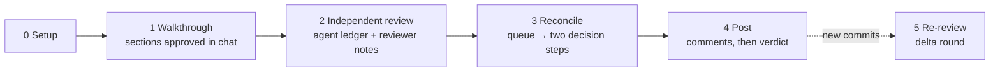

# PR Review — Collaborative

## What this skill does



- **Walkthrough:** propose the sections in chat; write the walkthrough once the reviewer approves them (use `va-visualize` for structural views).
- **Two independent reviews:** yours as a compact ledger in `agent_review.md`, the reviewer's free-form in `reviewer_review.md`.
- **Reconcile:** both are merged into `review_queue.md` and decided in two steps by source: reviewer rows approve-by-exception, agent rows as a keep-list; a re-review gates the previous items first. Each step's decided items are written to `final_review.json` in one call.

## Before you start

- `workspace_path`: the directory for this review session. Ask; there is no default.
- The PR branch is checked out locally and current with its remote. Confirm before starting.
- Ticket and PR intent come from `gh pr view`. `gh` reads and writes GitHub; local `git` supplies the diff.

## Gates

These hold in every phase.

1. **Sections.** The walkthrough is written from a section list the reviewer approved in chat.
2. **Blind review.** Write your findings without reading `reviewer_review.md`. They reach the reviewer in the reconcile steps, after the reviewer says their pass is done.
3. **Re-review.** On a later round, verify previous open items and inspect the delta diff independently in `agent_review.md` and `reviewer_review.md`. Read `references/phase-5-rereview.md` when new commits address a previous round.
4. **Sign-off.** The reviewer decides each reconcile gate (a re-review's previous-item statuses, then the approve-by-exception or keep-list rows), each posting batch (asked as counts) and the final verdict separately. Each gate is its own message: its table is shown alone, and the next gate's table comes in the reply after the reviewer's answer. An earlier yes does not cover a later gate, batch or verdict.
5. **Structured review data.** `final_review.json` is the sole source of truth (`new`, `unresolved` and `resolved` items) for the post and resolve scripts, and `scripts/walk_item.py` is how items get into it.

## Phases

Load the current phase's reference, and another only when it points to one.

| Phase | Trigger | Reference |
|---|---|---|
| **0 — Setup** | Start of session | `references/phase-0-setup.md` |
| **1 — Walkthrough** | After Phase 0 | `references/phase-1-walkthrough.md` |
| **2 — Independent Review** | Reviewer confirms after walkthrough | `references/phase-2-review.md` |
| **3 — Reconcile** | Reviewer says they're done reviewing | `references/phase-3-reconcile.md` |
| **4 — Post** | Reviewer approves the reconciled list | `references/phase-4-post.md` |
| **5 — Re-review** | New commits address a previous round | `references/phase-5-rereview.md` |

## Workspace

```
<workspace_path>/
  meta.json                         pr_number, owner, repo, branch_name, baseRefName, current_round
  rounds/1/
    round.json                      {round, headRefOid}
    diff.patch                      full diff, base...HEAD
    walkthrough.md                  one file; a large PR adds walkthrough/<group>.md files (phase 1)
    review/agent_review.md              compact ledger: one row per finding, issue only
    review/reviewer_review.md           free-form notes
    review/review_queue.md              Phase 3: merged queue with a Decision per row
    review/final_review.json            written per reconcile step
    review/verdict.md                   overall verdict body, drafted after posting
  rounds/N/                         see references/phase-5-rereview.md
```

## Review data (`final_review.json`)

Written in Phases 3 and 5 by `walk_item.py`; the single source of truth for posting and thread resolution.

```json
{
  "new": [
    {
      "title": "<summary>",
      "severity": "critical | major | minor",
      "file": "path/to/file",
      "line": 42,
      "issue": "<one line or snippet>",
      "why": "<rationale>",
      "suggestion": "Fix with:\n```dart\nfinal x = unwrap(y);\n```",
      "row": 3
    }
  ],
  "unresolved": [
    {
      "title": "<original title>",
      "comment_id": 123456789,
      "status": "Not Fixed | Partially Fixed",
      "evidence": "<reason/snippet>",
      "reply": "<optional comment thread reply>"
    }
  ],
  "resolved": [
    {
      "title": "<original title>",
      "comment_id": 123456789,
      "status": "Fixed | Moot",
      "evidence": "<verification proof>",
      "reply": "<optional resolution note>"
    }
  ]
}
```

| Field | Meaning |
|---|---|
| `issue`, `why`, `suggestion`, `evidence`, `reply` | Rich Markdown: fenced code blocks with language tags, lists, inline backticks |
| `line` | Diff `+`-side line number, or `null` for deletion-only (posts file-level). Check with `scripts/diff_lines.py <workspace> <file>` |
| `severity` | `critical` (bug / data loss), `major` (behavioral gap), `minor` (non-blocking) |
| `row` | The item's `review_queue.md` row, written by `walk_item.py` |
| `status` | `Fixed` (landed), `Moot` (code moved/gone), `Partially Fixed` (part remains), `Not Fixed` (unchanged) |
| `verdict` | Optional, top level: `{event, review_id, url}`, written by `post_verdict.py` once the round's verdict is posted |

## Scripts

All live in this skill's `scripts/` directory and default to `current_round` in `meta.json`; pass `--round N` for another round.

| Script | Does | Usage |
|---|---|---|
| `setup.py <workspace> [--exclude glob ...]` | Starts round 1 | Phase 0 |
| `setup.py <workspace> --round N [--exclude glob ...] [--include-base-merge]` | N = current + 1 starts the next round: delta diff without base-branch merge changes (unless `--include-base-merge`), open items pre-filled from the previous round. N = current refreshes head and diff in place. Round-1 excludes persist | Phase 5 |
| `diff_lines.py <workspace> <file>` | `+`-side hunk ranges for `line` | Phases 2, 3 |
| `walk_item.py add\|edit\|discard <workspace> ...` | Records decisions: validates items, writes or edits them in `final_review.json`, marks `review_queue.md` rows | Phase 3 |
| `post_all.py <workspace> [--dry-run]` | Posts unposted `new` items from `final_review.json` | Phase 4 |
| `post_comment.py <workspace>` | One-off comment outside the list | Phase 4 |
| `post_verdict.py <workspace> --draft \| --event APPROVE\|REQUEST_CHANGES\|COMMENT [--dry-run] [--force]` | Drafts `review/verdict.md` (`--draft [--event X]`) and posts it as the overall PR review, after the comments are posted and the reviewer approves | Phase 4 |
| `resolve_threads.py <workspace> [--dry-run] [--force]` | Resolves fixed threads and updates open threads with why they stay open, from `final_review.json`. Run before `post_all.py` | Phase 5 |
